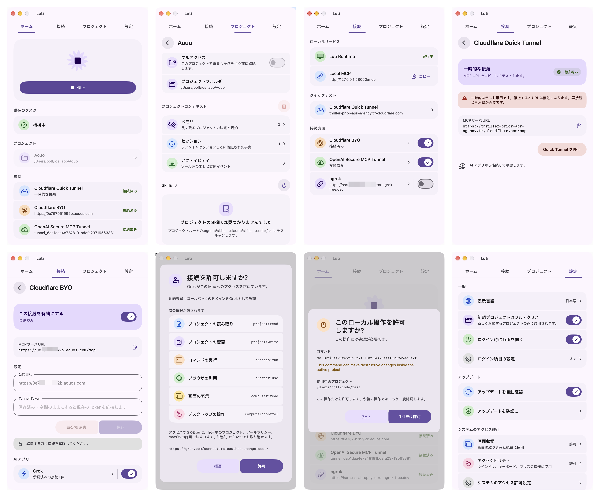
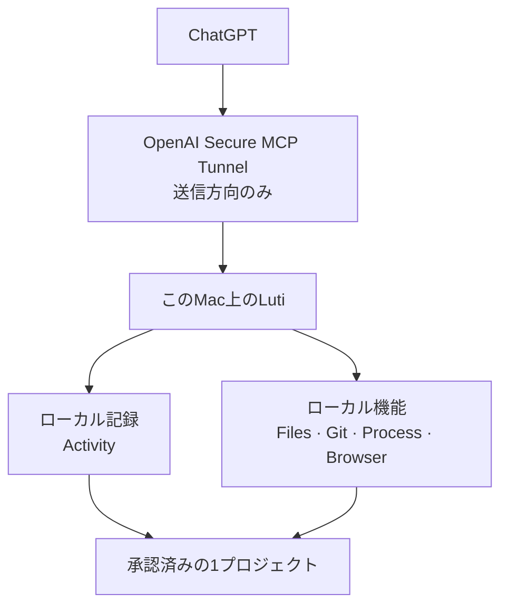

<div align="center">


# Luti

**AIのためのローカルプロジェクトランタイム。**

MCP対応のAIを、Mac上で選択したフォルダに接続します。Lutiはローカルツールと明確な権限境界を提供します。

[](LICENSE) [](#動作要件) [](#ソースからビルド)

[English](README.md) · [简体中文](README.zh-CN.md) · 日本語

[Website](https://luti.aouos.com/) · [Download](https://github.com/boltguo/Luti/releases/latest/download/Luti.dmg) · [GitHub](https://github.com/boltguo/Luti) · [Support](https://buymeacoffee.com/boltguo)

</div>

<p align="center">
  
</p>

## Lutiでできること

Lutiは、AIクライアントを承認済みのひとつのプロジェクトにつなぎます。推論とオーケストレーションはAI Hostが担い、ツールのローカル実行、プロジェクト境界と権限はLutiが管理します。



ファイルの読み書き、ビルドやテスト、Gitの確認、ブラウザの操作、成果物の書き出しに対応します。これらの操作はすべてMac上で実行されます。

## クイックスタート

1. **Lutiをインストール。** 最新のGitHub Releaseから署名済みのDMGを入手するか、ソースからビルドします。
2. **フォルダを追加。** **Projects**でフォルダを1つ選択します。フルアクセスが自動で適用され、削除すると空の状態に戻ります。
3. **OpenAI Tunnelを設定。** OpenAI PlatformのTunnel IDとランタイムAPIキーを保存すると、Runtimeの起動に合わせて自動で接続します。
4. **ChatGPTで使う。** [ChatGPT Plugins](https://chatgpt.com/plugins)で **+** > **Add custom MCP server** を選び、**Tunnel** を選択してTunnel IDを指定します。

Runtimeを起動する前に、ローカルでフォルダを選択します。

**1.2.0へのアップグレード：** 1.1形式で保存済みの設定と認証情報は保持されます。1.0.xデータの自動移行と削除は廃止しました。1.0.xから直接更新する場合や、以前の移行が完了していない場合は、プロジェクトフォルダを選び直し、Tunnel IDとAPIキーを再保存してください。

## 接続方式

| 接続 | 用意するもの | 認証 | 向いている用途 |
|---|---|---|---|
| **OpenAI Secure MCP Tunnel** | Tunnel ID + ランタイムAPIキー | ChatGPTワークスペースの関連付け | 公開Endpointなしで使うChatGPT |

LutiのMCP接続はOpenAI Tunnelのみです。Lutiは固定バージョンでハッシュ検証済みの`tunnel-client`をダウンロードし、OpenAIへ送信方向で接続します。公開Listenerはなく、OAuthフローもありません。接続ごとの新しいCredentialだけを受け付けるLoopback専用Listenerを接続が所有します。接続障害が起きてもRuntimeと実行中のJobは維持され、Lutiが自動的に再試行します。接続中または再接続中にTunnel IDやAPI Keyを変更する場合は、Runtimeを停止し、新しい設定を保存してから再起動してください。停止すると実行中のJobとLutiが管理するBrowser Sessionは終了します。システムのプロキシ設定を変更した後も、Runtimeの停止と再起動が必要です。

## 機能

Lutiは6領域・**24個のPublic MCP Tool**を公開します。MCPはローカルで選択したフォルダを使用し、`projects`、`memory`、`skills`のToolは公開しません。

| Domain | Public Tools | 範囲 |
|---|---|---|
| Project | `project_info`, `inspect_project`, `runtime_status` | 現在のWorkspace、Discovery、Runtime状態 |
| Files & Code | `list_directory`, `read_files`, `read_image`, `search_project`, `edit_files`, `path_action`, `code_query` | 検索、読み取り、編集、移動、構造化コード照会 |
| Process & Jobs | `run_process`, `run_shell`, `job_query`, `job_action` | Build、Test、長時間Job、Log、PTY入力、停止 |
| Git | `git_query` | Status、Diff、Log、Show、Blame。読み取り専用 |
| Browser | `browser_session`, `browser_observe`, `browser_action`, `browser_transfer`, `browser_inspect`, `browser_dialog`, `browser_evaluate` | Navigation、Action、Screenshot、Transfer、Console、Network、Dialog |
| Artifacts | `export_artifact`, `import_artifact` | 不変のエクスポート、制御されたインポート |

プロジェクト固有の動作は、そのプロジェクトのmanifest、instructions、tasksで定義します。Public Toolを増やす必要はありません。

最初に `project_info` を呼び出して、現在のWorkspaceと `projectToken` を取得します。Projectへの書き込み、コマンド実行、Browserの変更、Job入力にはこの値が必要です。ローカルで別のフォルダを選択するかRuntimeを再起動すると失効するため、不一致の場合は対象Workspaceを再確認してください。所有するJobの停止は古い値によって妨げられません。

`code_query` はインストール済みの言語サーバーを起動するため、現在の `projectToken` が必要です。言語サーバーは副作用を伴う場合があります。

Jobの結果はプロセス終了と認識したテスト結果を分け、限定した入力ファイルの状態を記録します。`reportPath` でコマンドが生成するJUnit XMLを指定できます。変更のない既存レポート、不完全な出力、証明できない入力の一貫性はunknown、入力の変更はstaleとして扱います。Project全体の正しさを保証するものではありません。

`import_artifact` は現在のProject Runtimeにある有効なArtifactを、最大32 MiBの新規Projectファイルとして保存します。上書き、実行、展開は行いません。チャット添付は現在の対象外とし、具体的なHostが検証可能なファイルバインディングを提供する場合にのみAdapterを再評価します。

`inspect_project`はTask Registryとスコープ内の指示元を簡潔に返します。フォルダ選択後、Startを押すと直接実行を開始します。

## ローカル記録

Lutiは容量を制限した実行履歴だけを`~/.luti/`に保存します。現在の実行で変更したファイルとJobの検証状態はメモリに保持します。Session、Memory、ファイル復元データを保存せず、プロジェクト内にもRuntimeメタデータを書き込みません。

## セキュリティとプライバシー

| 境界 | 動作 |
|---|---|
| **Project Scope** | ファイルとProject操作を現在の承認済みProjectに限定 |
| **Permission Mode** | Lutiは選択したフォルダ内で常にフルアクセスを使用。外部操作の権限境界は維持します |
| **Credential** | Runtime CredentialをmacOS Keychainに保存し、機密値を永続化前にRedact |
| **Remote Access** | 設定済みのOpenAI TunnelだけがLutiに到達。ListenerはLoopback専用でCredentialに結びつく |
| **Git** | 公開Git Capabilityは読み取り専用 |
| **ブラウザ自動化** | Lutiが所有するBrowser Sessionのみを操作。デスクトップ撮影やマウス・キーボード操作は提供しません |
| **Process Execution** | `fullLocal`はユーザー権限で実行され、OS Sandboxではない |

Lutiには、プロジェクトデータを受け取るCloud Backendがありません。ただし、接続したAI Hostには要求したTool Resultが送られ、Source Code、Command Output、Screenshotなどが含まれる場合があります。有効にするAI HostとTunnel Providerは、いずれも信頼境界の一部です。

## 動作要件

- macOS 14以降。
- Apple Silicon Mac（arm64）。
- Browser Runtimeには別途Google Chromeが必要。
- ソースビルドにはXcode 26+を推奨。
- OpenAIアカウント、設定済みのTunnelとランタイムAPIキー。

アプリは英語、簡体字中国語、日本語に対応しています。

## ソースからビルド

```bash
git clone https://github.com/boltguo/Luti.git
cd Luti
open Luti.xcodeproj
```

主なSchemeは`Luti`と`LutiProcessHost`です。App targetは**Apple Development**で自動署名します。Signing & Capabilitiesで自分のTeamに変更するか、**Sign to Run Locally**を選択してください。Production ReleaseはHardened Runtimeを有効にし、署名・公証済みDMGとして配布します。Sparkleは署名済みUpdateを確認しますが、自動ではインストールしません。

## オープンソース

Lutiは[Apache License 2.0](LICENSE)で公開しています。Third-party DependencyとBundled RuntimeのLicense Noticeは[THIRD_PARTY_NOTICES](THIRD_PARTY_NOTICES)にまとめています。

変更を提案する前に[CONTRIBUTING.md](CONTRIBUTING.md)を確認してください。脆弱性は[SECURITY.md](SECURITY.md)に従って非公開で報告してください。

Lutiが役に立ったら、[Buy Me a Coffee](https://buymeacoffee.com/boltguo)から開発を支援できます。
