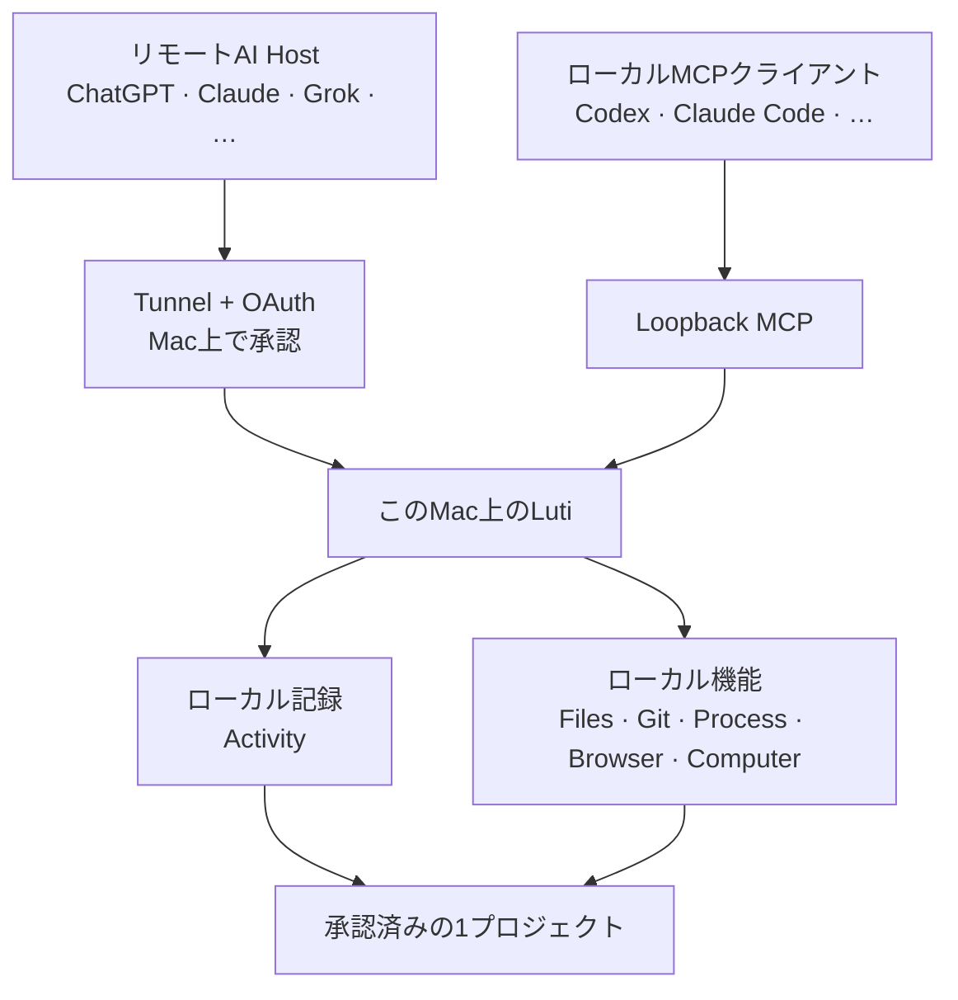

<div align="center">


# Luti

**AIのためのローカルプロジェクトランタイム。**

MCP対応のAIを、Mac上で選択したフォルダに接続します。Lutiはローカルツールと明確な権限境界を提供します。

[](LICENSE) [](#動作要件) [](#ソースからビルド)

[English](README.md) · [简体中文](README.zh-CN.md) · 日本語

[Website](https://luti.aouos.com/) · [Download](https://github.com/boltguo/Luti/releases/latest/download/Luti.dmg) · [GitHub](https://github.com/boltguo/Luti) · [Support](https://buymeacoffee.com/boltguo)

</div>

<p align="center">
  
</p>

## Lutiでできること

Lutiは、AIクライアントを承認済みのひとつのプロジェクトにつなぎます。推論とオーケストレーションはAI Hostが担い、ツールのローカル実行、プロジェクト境界と権限はLutiが管理します。



ファイルの読み書き、ビルドやテスト、Gitの確認、ブラウザやデスクトップの操作、成果物の書き出しに対応します。これらの操作はすべてMac上で実行されます。

## クイックスタート

1. **Luti Liteをビルド。** 以下の手順で、このブランチのソースからビルドします。
2. **フォルダを追加。** **Projects**でフォルダを1つ選択します。フルアクセスが自動で適用され、削除すると空の状態に戻ります。
3. **Cloudflare BYOを設定。** 公開URLとTunnel Tokenを保存すると、Runtimeの起動に合わせて自動で接続します。
4. **AIを接続。** LutiをMCP Serverとして追加します。Public OAuth ClientはDCR + PKCEで登録したあと、このMac上での承認を待ちます。

Runtimeを起動する前に、ローカルでフォルダを選択します。複数の接続を同時に動かし、同じフォルダで作業できます。

旧バージョンの複数プロジェクト設定では、選択中のプロジェクトを優先し、不明ならリストの先頭を保持します。フルアクセスの単一フォルダ設定として保存し、設定が空または読み取れない場合は空の状態から再選択します。ファイルとローカル記録は保持します。

## 接続方式

| 接続 | 用意するもの | 認証 | 向いている用途 |
|---|---|---|---|
| **Cloudflare BYO** | HTTPS Origin + Cloudflare Tunnel Token | Luti OAuth + Mac上の承認 | 自分の安定したCloudflare Endpoint |

Cloudflareでは、設定後に完全な`/mcp` URLが表示され、そのままコピーできます。Public Originを変更すると、古いOriginに結びついた認可は無効になります。

Local MCPとCloudflareは独立したListenerで動作します。Cloudflareに問題が起きても、ローカルRuntimeと実行中のJobは停止しません。

接続ページにはCloudflareの設定だけを表示し、ホームには接続状態を常に表示します。AIアプリの一覧はCloudflareの設定下に表示します。

## 機能

このLiteブランチは7領域・**27個のPublic MCP Tool**を公開します。MCPはローカルで選択したフォルダを使用し、`projects`、`memory`、`skills`のToolは公開しません。

| Domain | Public Tools | 範囲 |
|---|---|---|
| Project | `project_info`, `inspect_project`, `runtime_status` | 現在のWorkspace、Discovery、Runtime状態 |
| Files & Code | `list_directory`, `read_files`, `read_image`, `search_project`, `edit_files`, `path_action`, `code_query` | 検索、読み取り、編集、移動、構造化コード照会 |
| Process & Jobs | `run_process`, `run_shell`, `job_query`, `job_action` | Build、Test、長時間Job、Log、PTY入力、停止 |
| Git | `git_query` | Status、Diff、Log、Show、Blame。読み取り専用 |
| Browser | `browser_session`, `browser_observe`, `browser_action`, `browser_transfer`, `browser_inspect`, `browser_dialog`, `browser_evaluate` | Navigation、Action、Screenshot、Transfer、Console、Network、Dialog |
| Computer | `computer_observe`, `computer_action`, `computer_wait` | macOSの観察、入力、状態待ち |
| Artifacts | `export_artifact`, `import_artifact` | 不変のエクスポート、制御されたインポート |

プロジェクト固有の動作は、そのプロジェクトのmanifest、instructions、tasksで定義します。Public Toolを増やす必要はありません。

最初に `project_info` を呼び出して、現在のWorkspaceと `projectToken` を取得します。Projectへの書き込み、コマンド実行、Browserの変更、Job入力にはこの値が必要です。ローカルで別のフォルダを選択するかRuntimeを再起動すると失効するため、不一致の場合は対象Workspaceを再確認してください。所有するJobの停止は古い値によって妨げられません。Project書き込み、プロセス実行、Browser利用のいずれかの権限があり、Project読み取り権限がない接続には、`projectId`、`generation`、`projectToken`だけを返します。

リソースの一覧、読み取り、インポートでは、Projectファイル、プロセスログ、ブラウザ成果物、画面キャプチャそれぞれの権限を確認します。ブラウザへのアップロードにはProject読み取り権限も必要です。`code_query` はインストール済みの言語サーバーを起動するため、Project読み取り・プロセス実行権限と現在の `projectToken` が必要です。言語サーバーは副作用を伴う場合があります。

Jobの結果はプロセス終了と認識したテスト結果を分け、限定した入力ファイルの状態を記録します。`reportPath` でコマンドが生成するJUnit XMLを指定できます。変更のない既存レポート、不完全な出力、証明できない入力の一貫性はunknown、入力の変更はstaleとして扱います。Project全体の正しさを保証するものではありません。

`import_artifact` は現在のProject Runtimeにある有効なArtifactを、最大32 MiBの新規Projectファイルとして保存します。上書き、実行、展開は行いません。チャット添付は現在の対象外とし、具体的なHostが検証可能なファイルバインディングを提供する場合にのみAdapterを再評価します。

`inspect_project`はTask Registryとスコープ内の指示元を簡潔に返します。フォルダ選択後、Startを押すと直接実行を開始します。

## ローカル記録

Liteは容量を制限した実行履歴だけを`~/.luti/`に保存します。現在の実行で変更したファイルとJobの検証状態はメモリに保持します。Session、Memory、ファイル復元データを保存せず、プロジェクト内にもRuntimeメタデータを書き込みません。旧版のデータはそのまま残します。

## セキュリティとプライバシー

| 境界 | 動作 |
|---|---|
| **Project Scope** | ファイルとProject操作を現在の承認済みProjectに限定 |
| **Permission Mode** | Liteは選択したフォルダ内で常にフルアクセスを使用。外部操作の権限境界は維持します |
| **Credential** | Runtime CredentialをmacOS Keychainに保存し、機密値を永続化前にRedact |
| **OAuth** | Public ClientはOriginに結びつき、このMac上の承認が必要 |
| **Git** | 公開Git Capabilityは読み取り専用 |
| **Browser / Computer Use** | Lutiが所有するBrowser Sessionだけを操作し、画面収録とAccessibilityは独立したmacOS権限として扱う |
| **Process Execution** | `fullLocal`はユーザー権限で実行され、OS Sandboxではない |

AIアプリのアクセスをオフにすると、既存のOAuth Grantは一時停止します。再度オンにすれば、期限内のGrantをそのまま再開できます。**取り消す**と**クライアントを削除**は、アクセスを完全に無効化します。

Lutiには、プロジェクトデータを受け取るCloud Backendがありません。ただし、接続したAI Hostには要求したTool Resultが送られ、Source Code、Command Output、Screenshotなどが含まれる場合があります。有効にするAI HostとTunnel Providerは、いずれも信頼境界の一部です。

## 動作要件

- macOS 14以降。
- Core AppはApple SiliconとIntel Macで動作。
- 現在固定しているBrowser RuntimeはApple Siliconのみで、別途Google Chromeが必要。
- ソースビルドにはXcode 26+を推奨。
- 有効にする各Remote ProviderのAccountと設定。

アプリは英語、簡体字中国語、日本語に対応しています。

## ソースからビルド

```bash
git clone https://github.com/boltguo/Luti.git
cd Luti
open Luti.xcodeproj
```

主なSchemeは`Luti`と`LutiProcessHost`です。Local Debug Buildは**Sign to Run Locally**を使います。Production ReleaseはHardened Runtimeを有効にし、署名・公証済みDMGとして配布します。Liteには自動更新機能はありません。このブランチから再ビルドしてください。

## オープンソース

Lutiは[Apache License 2.0](LICENSE)で公開しています。Third-party DependencyとBundled RuntimeのLicense Noticeは[THIRD_PARTY_NOTICES](THIRD_PARTY_NOTICES)にまとめています。

変更を提案する前に[CONTRIBUTING.md](CONTRIBUTING.md)を確認してください。脆弱性は[SECURITY.md](SECURITY.md)に従って非公開で報告してください。

Lutiが役に立ったら、[Buy Me a Coffee](https://buymeacoffee.com/boltguo)から開発を支援できます。
