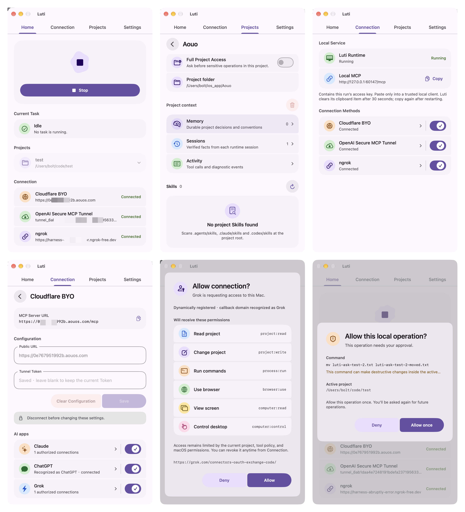

<div align="center">


# Luti

**A local project runtime for AI.**

Connect MCP-compatible AI clients to the folder selected on your Mac. Luti provides local tools and clear permission boundaries.

[](LICENSE) [](#requirements) [](#build-from-source)

English · [简体中文](README.zh-CN.md) · [日本語](README.ja.md)

[Website](https://luti.aouos.com/) · [Download](https://github.com/boltguo/Luti/releases/latest/download/Luti.dmg) · [GitHub](https://github.com/boltguo/Luti) · [Support](https://buymeacoffee.com/boltguo)

</div>

<p align="center">
  
</p>

## What Luti does

Luti connects an AI client to one approved project. The AI host handles reasoning and orchestration. Luti runs tools locally and enforces the project boundary and permissions. It can read and edit files, run builds and tests, inspect Git, drive a browser, export artifacts, and maintain project memory across AI clients. All of these operations run on your Mac.

## Get started

1. **Install Luti.** Download the signed DMG from the latest GitHub Release, or build it from source.
2. **Add a folder.** Choose one folder in **Projects**. Luti uses Full Project Access automatically; removing it returns the page to its empty state.
3. **Configure a connection.** In **Connections**, configure **OpenAI Secure MCP Tunnel** or **Cloudflare Tunnel** (either or both may be enabled).
4. **Start and connect.** Start the local Runtime, then add the MCP server in your AI client.

**Upgrading to 1.2.0:** Settings and credentials already saved in the 1.1 format are retained. Automatic migration and cleanup of 1.0.x data have been removed. If upgrading directly from 1.0.x, or if an earlier migration did not finish, select the project folder and save the Tunnel ID and API key again.

## Connections and setup guides

| Connection | What you provide | Authentication | Best for |
|---|---|---|---|
| **OpenAI Secure MCP Tunnel** | Tunnel ID + runtime API key | ChatGPT workspace association | ChatGPT, with no public endpoint |
| **Cloudflare Tunnel** | HTTPS domain + Tunnel Token | OAuth approved via Luti popup on this Mac | Custom MCP clients using a stable public URL |

OpenAI uses its private, credential-bound loopback listener and outbound `tunnel-client`; Cloudflare adds an independent OAuth-protected listener for a named HTTPS domain. Either connection can start the runtime, and both may run together. Failed transports reconnect without restarting project jobs. Stop the runtime before changing connection settings; stopping also ends jobs and browser sessions. See [Cloudflare setup and authorization](docs/cloudflare.md).

### 1. OpenAI Secure MCP Tunnel (ChatGPT)

1. **Create a Secure MCP Tunnel**: In [OpenAI Platform Tunnel settings](https://platform.openai.com/settings/organization/tunnels), create a Tunnel and associate the ChatGPT workspace that will use it (requires `Tunnels Read + Manage`).
2. **Create a runtime API key**: In [OpenAI API Keys](https://platform.openai.com/api-keys), create an API key for `tunnel-client` (requires `Tunnels Read + Use`).
3. **Finish setup in Luti**: Enter the Tunnel ID and Runtime API Key and save. Luti connects automatically while running.
4. **Add it in ChatGPT**: In [ChatGPT Plugins](https://chatgpt.com/plugins), select **+** > **Add custom MCP server**, choose **Tunnel** under Connection, and select your Tunnel ID while Luti is connected.

### 2. Cloudflare Tunnel (Standard Web OAuth clients: ChatGPT / Claude / Grok / Gemini)

1. **Create a Cloudflare Tunnel**: In the [Cloudflare Tunnel dashboard](https://one.dash.cloudflare.com/), create or select a remotely managed Cloudflared tunnel and copy its Tunnel Token.
2. **Route your public hostname**: Add a Public Hostname for your HTTPS domain (e.g. `https://mcp.example.com`) and route the service URL to `http://127.0.0.1:39393`.
3. **Finish setup in Luti**: Enter the HTTPS domain and Tunnel Token and save. When enabled, Luti connects automatically while running.
4. **Add in your AI client and approve**: Add `https://<your-domain>/mcp` as a custom MCP server with **OAuth**, verify the browser code, and click **Allow access** in the Luti approval dialog on this Mac.

### 3. Sandbox / Scripted Clients without a Web Callback (Manual Python OAuth)

For sandboxed AI agents or scripts without a public callback backend: the client generates the authorization URL → the user opens it in a browser and approves the popup in Luti → the user pastes the final redirected callback URL back to the client → the client exchanges `code` for tokens and calls `/mcp`.

1. **Discovery & Dynamic Client Registration (DCR)**
   - Discovery: `GET /.well-known/oauth-authorization-server` and `GET /.well-known/oauth-protected-resource/mcp`
   - Register: `POST /oauth/register` with JSON body `{"client_name": "...", "redirect_uris": ["https://..."], "grant_types": ["authorization_code", "refresh_token"], "response_types": ["code"], "scope": "mcp", "token_endpoint_auth_method": "none"}`. Save the returned `client_id` (`luti_` prefix). Sandboxed clients may register a valid `https://` placeholder callback URI and copy the redirected URL manually.
2. **Generate PKCE Authorization URL & Approve**
   - Generate and persist `verifier`, `S256` `code_challenge`, and random `state`, then build `/oauth/authorize?response_type=code&client_id=...&redirect_uri=...&scope=mcp&state=...&code_challenge=...&code_challenge_method=S256&resource=https://<your-domain>/mcp`.
   - **Send the authorization URL as plain text / code block** (never as a rich link preview card, as chat link prefetchers will hit `/oauth/authorize` prematurely). After approving in Luti on the Mac, paste back the full redirected URL (`?code=...&state=...`).
3. **Exchange & Rotate Tokens (Key Rules)**
   - **One-time refresh rotation & replay guard**: `access_token` is an opaque token valid for 3600 seconds (cache and reuse it; do not refresh on every call). `refresh_token` is **single-use rotating**: each refresh invalidates the previous `refresh_token` immediately, so **persist the new pair with `0600` permissions right away**. Re-submitting a spent `refresh_token` triggers replay protection and **revokes the entire grant** (do not blindly retry with the old `refresh_token` after a network timeout).
   - **Call `/mcp`**: Send `initialize` + `notifications/initialized`, then `tools/list` / `tools/call` (mutating tools require `projectToken` from `project_info`).

```python
import base64, hashlib, json, secrets, urllib.parse, urllib.request

BASE, UA = "https://mcp.example.com", "Mozilla/5.0"
RES, CID, REDIRECT = f"{BASE}/mcp", "<client_id>", "<registered_redirect_uri>"

def build_auth_url():
    verifier = base64.urlsafe_b64encode(secrets.token_bytes(32)).rstrip(b"=").decode()
    challenge = base64.urlsafe_b64encode(hashlib.sha256(verifier.encode()).digest()).rstrip(b"=").decode()
    state = secrets.token_urlsafe(16)
    qs = urllib.parse.urlencode({
        "response_type": "code", "client_id": CID, "redirect_uri": REDIRECT,
        "scope": "mcp", "state": state, "code_challenge": challenge,
        "code_challenge_method": "S256", "resource": RES,
    })
    return f"{BASE}/oauth/authorize?{qs}", verifier, state

def exchange_or_refresh(form):
    data = urllib.parse.urlencode({"client_id": CID, "resource": RES, **form}).encode()
    req = urllib.request.Request(f"{BASE}/oauth/token", data=data,
        headers={"Content-Type": "application/x-www-form-urlencoded", "User-Agent": UA})
    return json.load(urllib.request.urlopen(req, timeout=25))  # Persist new access_token & refresh_token immediately

def mcp_call(access_token, method, params=None, mid=1):
    body = json.dumps({"jsonrpc": "2.0", "id": mid, "method": method, "params": params or {}}).encode()
    req = urllib.request.Request(RES, data=body, headers={
        "Content-Type": "application/json", "Accept": "application/json, text/event-stream",
        "Authorization": f"Bearer {access_token}", "User-Agent": UA})
    raw = urllib.request.urlopen(req, timeout=30).read().decode()
    for line in raw.splitlines():
        if line.startswith("data:"):
            return json.loads(line[5:])
    return json.loads(raw)
```

## Capabilities

Luti exposes **25 public MCP tools** across seven domains. MCP uses the folder selected locally, with no `projects` or `skills` tool.

| Domain | Public tools | Scope |
|---|---|---|
| Memory | `memory` | Project `MEMORY.md` index and topic `.md` decision files (`index`, `read`, `write`, `delete`) |
| Project | `project_info`, `inspect_project`, `runtime_status` | Current workspace, discovery, runtime state |
| Files & Code | `list_directory`, `read_files`, `read_image`, `search_project`, `edit_files`, `path_action`, `code_query` | Search, read, edit, move, structured code queries |
| Process & Jobs | `run_process`, `run_shell`, `job_query`, `job_action` | Builds, tests, long jobs, logs, PTY input, stop |
| Git | `git_query` | Status, diff, log, show, blame; read-only |
| Browser | `browser_session`, `browser_observe`, `browser_action`, `browser_transfer`, `browser_inspect`, `browser_dialog`, `browser_evaluate` | Navigation, actions, screenshots, transfers, console, network, dialogs |
| Artifacts | `export_artifact`, `import_artifact` | Immutable exports and controlled imports |

Project-specific behavior comes from the project's own manifest, instructions, and tasks rather than an expanding public tool set.

Start with `project_info` for the current workspace and `projectToken`. Project writes, memory mutations (`write`/`delete`), command execution, browser mutations and Job input require this token. It changes after selecting a different folder locally or restarting the Runtime; re-observe the intended workspace after a mismatch. Stopping an owned Job remains available without a current token.

`code_query` starts an installed language server and requires the current `projectToken`; the server may have side effects.

Job results separate process completion from recognized test results and record a bounded set of observed input files. `reportPath` can name a JUnit XML report produced by the command. Unchanged reports, incomplete output and unproven input consistency remain unknown; changed inputs are marked stale. These observations do not prove the entire project is correct.

`import_artifact` saves an unexpired artifact from the current project runtime to a new project file, up to 32 MiB. It does not overwrite, execute or unpack files. Chat attachments are outside the current scope; evaluate a Host adapter only when a concrete Host exposes a verified file binding.

`inspect_project` returns a compact task registry and scoped instruction sources. Selecting a folder and pressing Start enables full local execution directly.

## Local records

Luti stores per-project memory (`MEMORY.md` index and topic `.md` decision files) and bounded execution activity in `~/.luti/`. Current-run changed paths and job validation stay in memory. It does not persist session journals or file recovery data, and does not write runtime metadata into the project repository.

## Security and privacy

| Boundary | Behavior |
|---|---|
| **Project scope** | File and project operations stay inside the active approved project |
| **Permission mode** | Luti always uses `Full Project Access` within the selected folder; external operations retain their permission boundaries |
| **Secrets** | Runtime credentials use macOS Keychain; sensitive values are redacted before persistence |
| **Remote access** | Separate loopback listeners: OpenAI uses a private transport credential; Cloudflare requires domain-bound OAuth approved on this Mac |
| **Git** | Public Git capability is read-only |
| **Browser automation** | Luti owns its browser sessions; desktop capture and input are unavailable |
| **Process execution** | `fullLocal` runs with your user privileges and is not an OS sandbox |

Luti has no cloud backend that receives project data. The AI hosts you connect still receive the tool results you request, which may include source code, command output, screenshots, or other project data. Every AI host and tunnel provider you enable is part of your trust boundary.

## Requirements

- macOS 14 or later.
- An Apple Silicon Mac (arm64).
- A separately installed Google Chrome for browser automation with the pinned browser runtime.
- Xcode 26+ recommended for source builds.
- An OpenAI account with a configured Tunnel and runtime API key.

The app includes English, Simplified Chinese, and Japanese.

## Build from source

```bash
git clone https://github.com/boltguo/Luti.git
cd Luti
open Luti.xcodeproj
```

The main schemes are `Luti` and `LutiProcessHost`. The app target signs with **Apple Development** (automatic); set your own Team under Signing & Capabilities, or choose **Sign to Run Locally**. Production releases keep Hardened Runtime enabled and ship as signed, notarized DMGs. Sparkle checks for signed updates but does not install them silently.

## Open source

Luti is licensed under the [Apache License 2.0](LICENSE). Third-party and bundled runtime notices are listed in [THIRD_PARTY_NOTICES](THIRD_PARTY_NOTICES).

Read [CONTRIBUTING.md](CONTRIBUTING.md) before proposing a change. Follow [SECURITY.md](SECURITY.md) to report a vulnerability privately.

If Luti is useful to you, you can support development on [Buy Me a Coffee](https://buymeacoffee.com/boltguo).
