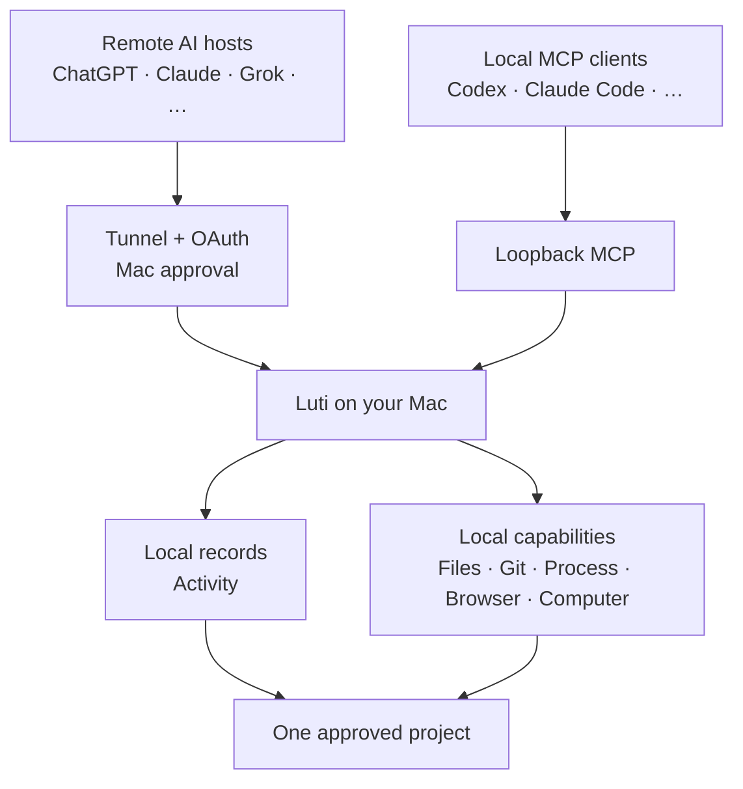

<div align="center">


# Luti

**A local project runtime for AI.**

Connect MCP-compatible AI clients to the folder selected on your Mac. Luti provides local tools and clear permission boundaries.

[](LICENSE) [](#requirements) [](#build-from-source)

English · [简体中文](README.zh-CN.md) · [日本語](README.ja.md)

[Website](https://luti.aouos.com/) · [Download](https://github.com/boltguo/Luti/releases/latest/download/Luti.dmg) · [GitHub](https://github.com/boltguo/Luti) · [Support](https://buymeacoffee.com/boltguo)

</div>

<p align="center">
  
</p>

## What Luti does

Luti connects an AI client to one approved project. The AI host handles reasoning and orchestration. Luti runs tools locally and enforces the project boundary and permissions.



It can read and edit files, run builds and tests, inspect Git, drive a browser, interact with the desktop, and export artifacts. All of these operations run on your Mac.

## Get started

1. **Build Luti Lite.** Build this branch from source using the instructions below.
2. **Add a folder.** Choose one folder in **Projects**. Lite uses Full Project Access automatically; removing it returns the page to its empty state.
3. **Configure Cloudflare BYO.** Save your public origin and Tunnel token. The connection starts with the runtime automatically.
4. **Connect your AI.** Add Luti as an MCP server. Public OAuth clients use DCR + PKCE, then wait for approval on this Mac.

Select the active folder locally before starting the Runtime. Enabled providers run in parallel and work in that same folder.

When loading an older multi-project configuration, Lite retains the selected project, or the first entry if the selection is unknown, and saves one folder with Full Project Access. Empty or unreadable configurations return to the empty state for a new selection. Files and local records are preserved.

## Connections

| Connection | What you provide | Authentication | Best for |
|---|---|---|---|
| **Cloudflare BYO** | HTTPS origin + Cloudflare Tunnel token | Luti OAuth + Mac approval | Your own stable Cloudflare endpoint |

Once configured, Cloudflare displays the full `/mcp` URL for direct copying. Changing the public origin invalidates authorizations tied to the old origin.

Local MCP and Cloudflare use separate listeners. A Cloudflare failure leaves the local runtime and running jobs available.

The Connections page shows Cloudflare configuration directly. Home always shows its connection status. Approved AI apps appear below the Cloudflare settings.

## Capabilities

This Lite branch exposes **27 public MCP tools** across seven domains. MCP uses the folder selected locally, with no `projects`, `memory` or `skills` tool.

| Domain | Public tools | Scope |
|---|---|---|
| Project | `project_info`, `inspect_project`, `runtime_status` | Current workspace, discovery, runtime state |
| Files & Code | `list_directory`, `read_files`, `read_image`, `search_project`, `edit_files`, `path_action`, `code_query` | Search, read, edit, move, structured code queries |
| Process & Jobs | `run_process`, `run_shell`, `job_query`, `job_action` | Builds, tests, long jobs, logs, PTY input, stop |
| Git | `git_query` | Status, diff, log, show, blame; read-only |
| Browser | `browser_session`, `browser_observe`, `browser_action`, `browser_transfer`, `browser_inspect`, `browser_dialog`, `browser_evaluate` | Navigation, actions, screenshots, transfers, console, network, dialogs |
| Computer | `computer_observe`, `computer_action`, `computer_wait` | macOS observation, input, state waiting |
| Artifacts | `export_artifact`, `import_artifact` | Immutable exports and controlled imports |

Project-specific behavior comes from the project's own manifest, instructions, and tasks rather than an expanding public tool set.

Start with `project_info` for the current workspace and `projectToken`. Project writes, command execution, browser mutations and Job input require this token. It changes after selecting a different folder locally or restarting the Runtime; re-observe the intended workspace after a mismatch. Stopping an owned Job remains available without a current token. Connections with project-write, process-run or browser-use permission but no project-read permission receive only `projectId`, `generation` and `projectToken`.

Resource listing, reads and imports check the permission for the source: project files, process logs, browser artifacts or desktop screenshots. Browser uploads also require project-read permission. `code_query` starts an installed language server, so it requires project-read and process-run permissions plus the current `projectToken`; the server may have side effects.

Job results separate process completion from recognized test results and record a bounded set of observed input files. `reportPath` can name a JUnit XML report produced by the command. Unchanged reports, incomplete output and unproven input consistency remain unknown; changed inputs are marked stale. These observations do not prove the entire project is correct.

`import_artifact` saves an unexpired artifact from the current project runtime to a new project file, up to 32 MiB. It does not overwrite, execute or unpack files. Chat attachments are outside the current scope; evaluate a Host adapter only when a concrete Host exposes a verified file binding.

`inspect_project` returns a compact task registry and scoped instruction sources, without duplicate legacy projections. Selecting a folder and pressing Start enables full local execution directly.

## Local records

Lite keeps bounded execution activity in `~/.luti/` for diagnostics. Current-run changed paths and job validation stay in memory. It does not persist sessions, memory or file recovery data, and does not write runtime metadata into the project repository. Existing retired data is left untouched.

## Security and privacy

| Boundary | Behavior |
|---|---|
| **Project scope** | File and project operations stay inside the active approved project |
| **Permission mode** | Lite always uses `Full Project Access` within the selected folder; external operations retain their permission boundaries |
| **Secrets** | Runtime credentials use macOS Keychain; sensitive values are redacted before persistence |
| **OAuth** | Public clients are origin-bound and require approval on this Mac |
| **Git** | Public Git capability is read-only |
| **Browser & Computer Use** | Luti owns its browser sessions; Screen Recording and Accessibility remain separate macOS permissions |
| **Process execution** | `fullLocal` runs with your user privileges and is not an OS sandbox |
| **Sandbox profiles** | `workspace` and `isolated` fail closed when an OS-enforced backend is unavailable |

Turning off access for an AI app pauses its existing OAuth grants. Turning access back on resumes grants that have not expired. **Revoke** and **Delete client** invalidate access permanently.

Luti has no cloud backend that receives project data. The AI hosts you connect still receive the tool results you request, which may include source code, command output, screenshots, or other project data. Every AI host and tunnel provider you enable is part of your trust boundary.

## Requirements

- macOS 14 or later.
- The core app runs on Apple Silicon and Intel.
- Apple Silicon and a separately installed Google Chrome for browser automation with the pinned browser runtime.
- Xcode 26+ recommended for source builds.
- An account and configuration for each remote provider you enable.

The app includes English, Simplified Chinese, and Japanese.

## Build from source

```bash
git clone https://github.com/boltguo/Luti.git
cd Luti
open Luti.xcodeproj
```

The main schemes are `Luti` and `LutiProcessHost`. Local Debug builds use **Sign to Run Locally**. Production releases keep Hardened Runtime enabled and ship as signed, notarized DMGs. Lite has no built-in updater; rebuild it from this branch.

## Open source

Luti is licensed under the [Apache License 2.0](LICENSE). Third-party and bundled runtime notices are listed in [THIRD_PARTY_NOTICES](THIRD_PARTY_NOTICES).

Read [CONTRIBUTING.md](CONTRIBUTING.md) before proposing a change. Follow [SECURITY.md](SECURITY.md) to report a vulnerability privately.

If Luti is useful to you, you can support development on [Buy Me a Coffee](https://buymeacoffee.com/boltguo).
