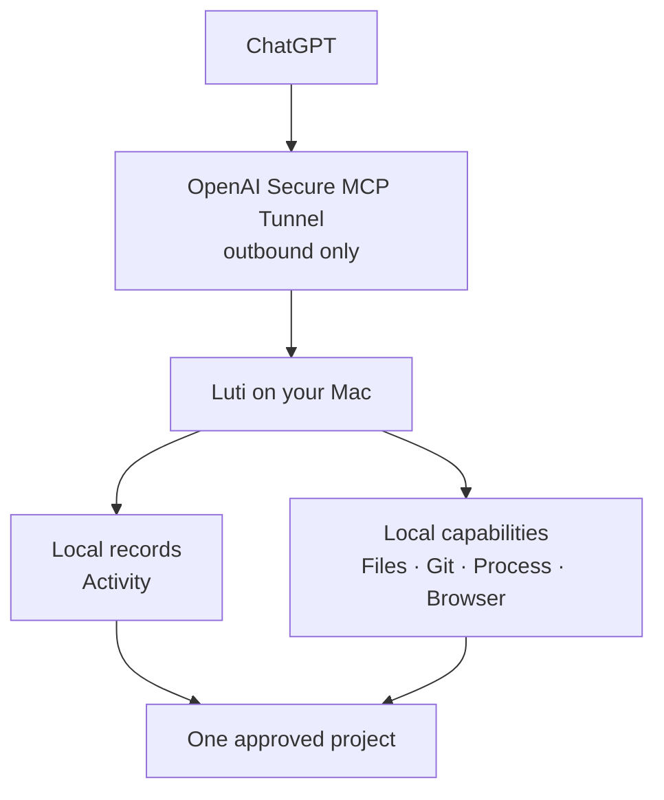

<div align="center">


# Luti

**A local project runtime for AI.**

Connect MCP-compatible AI clients to the folder selected on your Mac. Luti provides local tools and clear permission boundaries.

[](LICENSE) [](#requirements) [](#build-from-source)

English · [简体中文](README.zh-CN.md) · [日本語](README.ja.md)

[Website](https://luti.aouos.com/) · [Download](https://github.com/boltguo/Luti/releases/latest/download/Luti.dmg) · [GitHub](https://github.com/boltguo/Luti) · [Support](https://buymeacoffee.com/boltguo)

</div>

<p align="center">
  
</p>

## What Luti does

Luti connects an AI client to one approved project. The AI host handles reasoning and orchestration. Luti runs tools locally and enforces the project boundary and permissions.



It can read and edit files, run builds and tests, inspect Git, drive a browser and export artifacts. All of these operations run on your Mac.

## Get started

1. **Install Luti.** Download the signed DMG from the latest GitHub Release, or build it from source.
2. **Add a folder.** Choose one folder in **Projects**. Luti uses Full Project Access automatically; removing it returns the page to its empty state.
3. **Configure the OpenAI tunnel.** Save the Tunnel ID and runtime API key from OpenAI Platform. The connection starts with the runtime automatically.
4. **Use it in ChatGPT.** In [ChatGPT Plugins](https://chatgpt.com/plugins), select **+** > **Add custom MCP server**, choose **Tunnel** and select your Tunnel ID.

Select the active folder locally before starting the Runtime.

## Connections

| Connection | What you provide | Authentication | Best for |
|---|---|---|---|
| **OpenAI Secure MCP Tunnel** | Tunnel ID + runtime API key | ChatGPT workspace association | ChatGPT, with no public endpoint |

Luti exposes MCP through the OpenAI tunnel only. Luti downloads the pinned, checksum-verified `tunnel-client`, which connects outbound to OpenAI; nothing listens publicly and there is no OAuth flow. The connection owns a private loopback listener that accepts only a fresh per-connection credential. A connection failure leaves project tools and running jobs alive; reconnect from the Connections page without restarting the runtime.

## Capabilities

Luti exposes **24 public MCP tools** across seven domains. MCP uses the folder selected locally, with no `projects`, `memory` or `skills` tool.

| Domain | Public tools | Scope |
|---|---|---|
| Project | `project_info`, `inspect_project`, `runtime_status` | Current workspace, discovery, runtime state |
| Files & Code | `list_directory`, `read_files`, `read_image`, `search_project`, `edit_files`, `path_action`, `code_query` | Search, read, edit, move, structured code queries |
| Process & Jobs | `run_process`, `run_shell`, `job_query`, `job_action` | Builds, tests, long jobs, logs, PTY input, stop |
| Git | `git_query` | Status, diff, log, show, blame; read-only |
| Browser | `browser_session`, `browser_observe`, `browser_action`, `browser_transfer`, `browser_inspect`, `browser_dialog`, `browser_evaluate` | Navigation, actions, screenshots, transfers, console, network, dialogs |
| Artifacts | `export_artifact`, `import_artifact` | Immutable exports and controlled imports |

Project-specific behavior comes from the project's own manifest, instructions, and tasks rather than an expanding public tool set.

Start with `project_info` for the current workspace and `projectToken`. Project writes, command execution, browser mutations and Job input require this token. It changes after selecting a different folder locally or restarting the Runtime; re-observe the intended workspace after a mismatch. Stopping an owned Job remains available without a current token.

`code_query` starts an installed language server and requires the current `projectToken`; the server may have side effects.

Job results separate process completion from recognized test results and record a bounded set of observed input files. `reportPath` can name a JUnit XML report produced by the command. Unchanged reports, incomplete output and unproven input consistency remain unknown; changed inputs are marked stale. These observations do not prove the entire project is correct.

`import_artifact` saves an unexpired artifact from the current project runtime to a new project file, up to 32 MiB. It does not overwrite, execute or unpack files. Chat attachments are outside the current scope; evaluate a Host adapter only when a concrete Host exposes a verified file binding.

`inspect_project` returns a compact task registry and scoped instruction sources, without duplicate legacy projections. Selecting a folder and pressing Start enables full local execution directly.

## Local records

Luti keeps bounded execution activity in `~/.luti/` for diagnostics. Current-run changed paths and job validation stay in memory. It does not persist sessions, memory or file recovery data, and does not write runtime metadata into the project repository.

## Security and privacy

| Boundary | Behavior |
|---|---|
| **Project scope** | File and project operations stay inside the active approved project |
| **Permission mode** | Luti always uses `Full Project Access` within the selected folder; external operations retain their permission boundaries |
| **Secrets** | Runtime credentials use macOS Keychain; sensitive values are redacted before persistence |
| **Remote access** | Only the configured OpenAI tunnel reaches Luti; its listener is loopback-only and credential-bound |
| **Git** | Public Git capability is read-only |
| **Browser automation** | Luti owns its browser sessions; desktop capture and input are unavailable |
| **Process execution** | `fullLocal` runs with your user privileges and is not an OS sandbox |
| **Sandbox profiles** | `workspace` and `isolated` fail closed when an OS-enforced backend is unavailable |

Luti has no cloud backend that receives project data. The AI hosts you connect still receive the tool results you request, which may include source code, command output, screenshots, or other project data. Every AI host and tunnel provider you enable is part of your trust boundary.

## Requirements

- macOS 14 or later.
- An Apple Silicon Mac (arm64).
- A separately installed Google Chrome for browser automation with the pinned browser runtime.
- Xcode 26+ recommended for source builds.
- An account and configuration for each remote provider you enable.

The app includes English, Simplified Chinese, and Japanese.

## Build from source

```bash
git clone https://github.com/boltguo/Luti.git
cd Luti
open Luti.xcodeproj
```

The main schemes are `Luti` and `LutiProcessHost`. The app target signs with **Apple Development** (automatic); set your own Team under Signing & Capabilities, or choose **Sign to Run Locally**. Production releases keep Hardened Runtime enabled and ship as signed, notarized DMGs. Sparkle checks for signed updates but does not install them silently.

## Open source

Luti is licensed under the [Apache License 2.0](LICENSE). Third-party and bundled runtime notices are listed in [THIRD_PARTY_NOTICES](THIRD_PARTY_NOTICES).

Read [CONTRIBUTING.md](CONTRIBUTING.md) before proposing a change. Follow [SECURITY.md](SECURITY.md) to report a vulnerability privately.

If Luti is useful to you, you can support development on [Buy Me a Coffee](https://buymeacoffee.com/boltguo).
