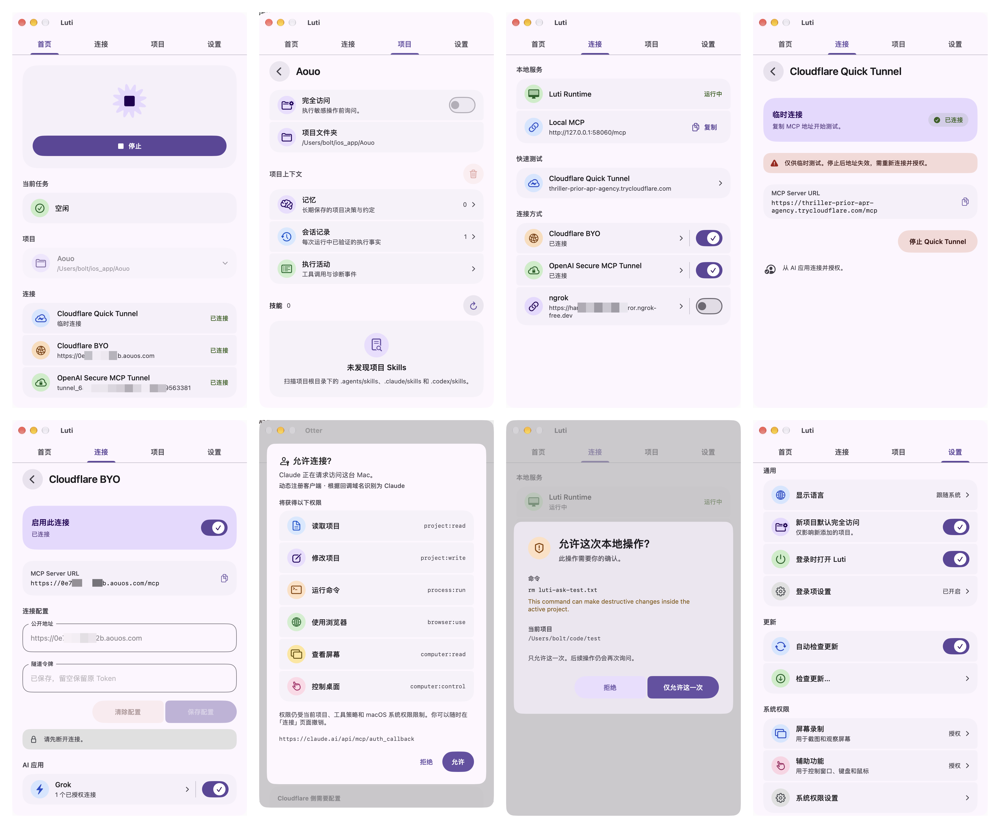
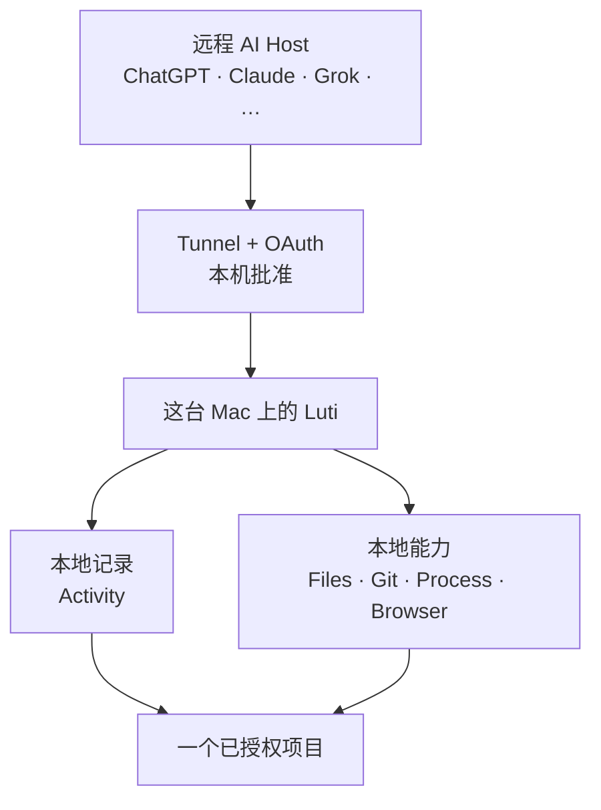

<div align="center">


# Luti

**一个给 AI 用的本地项目运行时。**

让支持 MCP 的 AI 连接到你在 Mac 上选定的文件夹。Luti 提供本地工具和清晰的权限边界。

[](LICENSE) [](#系统要求) [](#从源码构建)

[English](README.md) · 简体中文 · [日本語](README.ja.md)

[官网](https://luti.aouos.com/) · [下载](https://github.com/boltguo/Luti/releases/latest/download/Luti.dmg) · [GitHub](https://github.com/boltguo/Luti) · [支持开发](https://buymeacoffee.com/boltguo)

</div>

<p align="center">
  
</p>

## Luti 能做什么

Luti 把 AI 客户端连接到一个已授权项目。AI Host 负责推理和编排；Luti 在本机运行工具，并管理项目边界与权限。



它可以读写文件、运行构建和测试、查看 Git、操作浏览器、导出产物。这些操作都在你的 Mac 上完成。

## 快速开始

1. **构建 Luti Lite。** 按下方说明从此分支的源码构建。
2. **添加文件夹。** 在 **Projects** 中选择一个文件夹，默认完全访问。移除后回到空状态，可重新添加。
3. **配置 Cloudflare BYO。** 保存公开地址和 Tunnel Token，连接会随 Runtime 自动启动。
4. **连接 AI。** 把 Luti 添加为 MCP Server。公开 OAuth Client 使用 DCR + PKCE 注册，随后等待这台 Mac 批准。

启动 Runtime 前在本地选定文件夹。多个连接可以同时运行，使用同一个当前目录。

首次加载旧的多项目配置时，优先保留已选中的项目，否则保留列表第一个，并保存为默认完全访问的单文件夹配置。配置为空或无法解析时，回到空状态重新选择；磁盘文件与本地记录保留。

## 连接方式

| 连接 | 需要提供 | 认证 | 适合场景 |
|---|---|---|---|
| **Cloudflare BYO** | HTTPS Origin + Cloudflare Tunnel Token | Luti OAuth + 本机批准 | 使用自己的稳定 Cloudflare 入口 |

Cloudflare 配置完成后会显示完整的 `/mcp` 地址，可直接复制。修改 Public Origin 后，绑定在旧 Origin 上的授权会失效。

Lite 只提供 Cloudflare MCP 接入，不提供独立的本地 MCP 连接入口。Cloudflare 所需的回环监听由连接管理器持有；连接出错时，项目 Runtime 和已运行的 Job 不受影响。

连接页只展示 Cloudflare 配置，首页常驻显示它的连接状态，AI 应用列表位于 Cloudflare 配置下方。

## 能力

此 Lite 分支对外暴露 **24 个 MCP Tool**，分为 6 个领域。MCP 使用本地选定的文件夹，不提供 `projects`、`memory` 或 `skills` 工具。

| 领域 | Public Tools | 范围 |
|---|---|---|
| Project | `project_info`, `inspect_project`, `runtime_status` | 当前目录、发现、Runtime 状态 |
| Files & Code | `list_directory`, `read_files`, `read_image`, `search_project`, `edit_files`, `path_action`, `code_query` | 搜索、读取、编辑、移动、结构化代码查询 |
| Process & Jobs | `run_process`, `run_shell`, `job_query`, `job_action` | 构建、测试、长任务、日志、PTY 输入、停止 |
| Git | `git_query` | Status、Diff、Log、Show、Blame；只读 |
| Browser | `browser_session`, `browser_observe`, `browser_action`, `browser_transfer`, `browser_inspect`, `browser_dialog`, `browser_evaluate` | 导航、操作、截图、传输、Console、Network、Dialog |
| Artifacts | `export_artifact`, `import_artifact` | 不可变导出与受控导入 |

项目专属能力由项目自己的 manifest、instructions 和 tasks 提供，无需不断增加 Public Tool。

先调用 `project_info`，取得当前目录信息与 `projectToken`。项目写入、命令执行、浏览器修改和 Job 输入需携带该标识；在本地选择其他文件夹或重启 Runtime 后会失效。遇到失配应重新观察并确认目标目录。停止仍归 Runtime 管理的 Job 不受旧标识阻碍。具有项目写入、进程执行或浏览器权限，但未获项目读取权限的连接，只返回 `projectId`、`generation` 和 `projectToken`。

资源列举、读取和导入会检查来源对应的权限：项目文件、进程日志、浏览器产物。浏览器上传还需要项目读取权限。`code_query` 会启动已安装的语言服务，因此需要项目读取、进程执行权限及当前 `projectToken`；语言服务可能产生副作用。

Job 结果区分进程完成与识别到的测试结果，并记录有限范围的输入文件观察。`reportPath` 可指定命令生成的 JUnit XML 报告。旧报告、截断输出与无法证明的输入一致性保持 unknown，输入变化标为 stale；这些观察不能证明完整工程正确。

`import_artifact` 可把当前项目 Runtime 中尚未过期的产物保存为项目新文件，最大 32 MiB。不会覆盖、执行或解压文件。网页聊天附件不在当前范围内；只有出现明确 Host 需求且能验证可信文件绑定时再评估 Adapter。

`inspect_project` 统一返回精简的任务注册表和作用域内的指令来源，移除重复的旧格式。选择文件夹后，点击启动即可直接运行。

## 本地记录

Lite 只保留有容量限制的执行活动，存放于 `~/.luti/`，用于排查工具调用问题。本次运行的改动文件和任务验证状态保存在内存中。不会保存会话、记忆或文件恢复数据，也不会向项目仓库写入 Runtime 元数据。旧版停用的数据保留在磁盘上。

## 安全与隐私

| 边界 | 行为 |
|---|---|
| **项目范围** | 文件与项目操作限制在当前已授权项目中 |
| **权限模式** | Lite 默认对选定文件夹使用完全访问；外部操作仍遵守原有权限边界 |
| **凭据** | Runtime 凭据存入 macOS Keychain；敏感值在持久化前脱敏 |
| **OAuth** | Public Client 绑定 Origin，并且需要这台 Mac 批准 |
| **Git** | 对外 Git 能力只读 |
| **浏览器自动化** | Luti 只操作自己拥有的 Browser Session；Lite 不提供桌面截图或鼠标、键盘控制 |
| **进程执行** | `fullLocal` 使用当前用户权限执行，不是 OS Sandbox |

关闭某个 AI 应用的访问开关，只会暂停现有 OAuth 授权。重新开启后，未过期的授权会恢复；**撤销**和**删除客户端**则会永久终止访问。

Luti 没有接收项目数据的云端服务。连接到 Luti 的 AI Host 仍会收到你请求的工具结果，其中可能包含源码、命令输出、截图或其他项目数据。你启用的每个 AI Host 和 Tunnel Provider 都属于信任边界。

## 系统要求

- macOS 14 或更高版本。
- 核心应用可在 Apple Silicon 和 Intel Mac 上运行。
- 当前固定版本的 Browser Runtime 仅支持 Apple Silicon，并要求单独安装 Google Chrome。
- 从源码构建建议使用 Xcode 26+。
- 每个启用的远程 Provider 都需要相应账号与配置。

应用支持英语、简体中文和日语。

## 从源码构建

```bash
git clone https://github.com/boltguo/Luti.git
cd Luti
open Luti.xcodeproj
```

主要 Scheme 是 `Luti` 和 `LutiProcessHost`。本地 Debug 构建使用 **Sign to Run Locally**。正式版本启用 Hardened Runtime，并以签名、公证后的 DMG 分发。Lite 不包含自动更新；从此分支重新构建即可。

## 开源

Luti 使用 [Apache License 2.0](LICENSE)。第三方依赖与 Bundled Runtime 的许可证声明见 [THIRD_PARTY_NOTICES](THIRD_PARTY_NOTICES)。

提交变更前请阅读 [CONTRIBUTING.md](CONTRIBUTING.md)。发现安全漏洞时，请按照 [SECURITY.md](SECURITY.md) 私下报告。

如果 Luti 对你有帮助，可以通过 [Buy Me a Coffee](https://buymeacoffee.com/boltguo) 支持开发。
